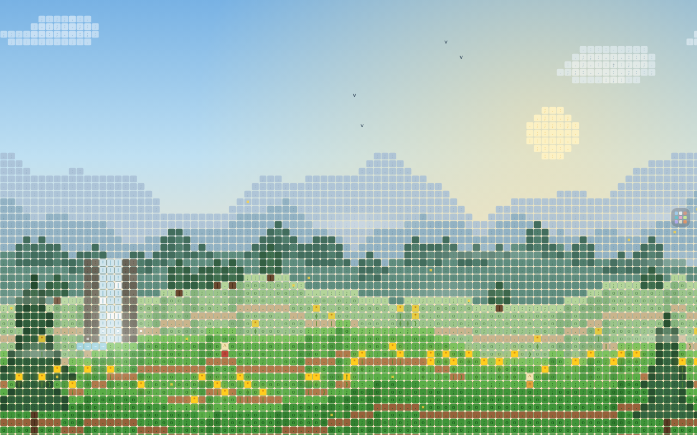

# Pixel Chat Themes + Bảo Lộc

Bản mở rộng của [aqua2409z/pixel-chat-themes](https://github.com/aqua2409z/pixel-chat-themes) (MIT), có thêm theme **Bảo Lộc – Lâm Đồng**.

## Cảnh Bảo Lộc
- Dãy núi xanh cao nguyên Lâm Đồng, mặt trời buổi sáng
- Rừng thông trên sườn đồi, có 2 cây thông lớn ở tiền cảnh
- Đồi chè xếp tầng, xen lối đất đỏ
- Thác nước kiểu Đambri đổ xuống từ vách đá
- Sương sớm trôi qua các thung lũng (rê chuột để đẩy sương)
- Hoa dã quỳ vàng đung đưa theo gió (rê chuột để làm hoa nghiêng), cánh hoa bay
- Người hái chè đội nón lá đi giữa các luống chè

## Cách bật
- Gõ `/theme bao loc` (hoặc `/theme lam dong`, `/theme da quy`, `/theme doi che`, `/theme thong`)
- Hoặc gõ `/theme` rồi chọn ô **Bảo Lộc** (ô thứ 2)

## Cài trên trình duyệt
1. Cài tiện ích Tampermonkey
2. Mở file `claude-pixel-themes.user.js` (bản raw trên GitHub) rồi bấm **Install**
3. ⚠️ Nếu đã cài bản gốc "Pixel Chat Themes", hãy **tắt bản gốc** để không chạy hai nền cùng lúc
4. Bản này đã bỏ chế độ tự cập nhật từ repo gốc, nên bản gốc sẽ không ghi đè mất theme Bảo Lộc

## Xem thử
Mở `index.html` bằng trình duyệt, gõ `/theme bao loc`.
